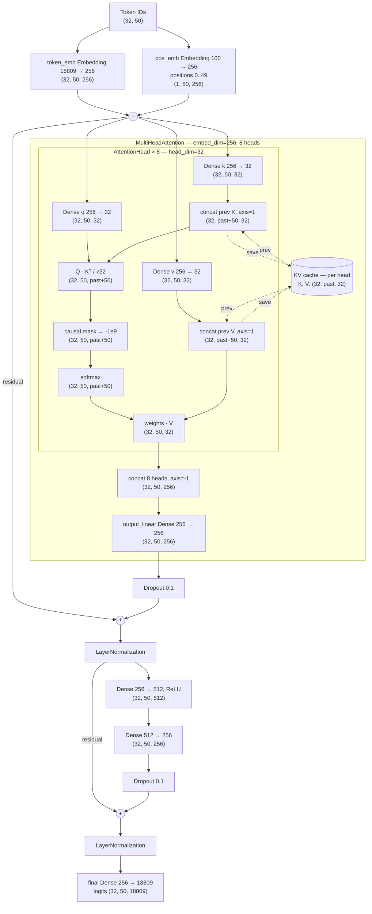

# LLM-style Text Generation Decoder

This project implements a lightweight LLM-style decoder for text generation. The model is built from **custom attention layers** (hand-written scaled dot-product attention, not `layers.MultiHeadAttention`) and learns to predict the next token in a sequence. It can generate text autoregressively using a per-head **Key-Value (KV) cache** for efficiency.

## Model Architecture

Shapes assume the word-level training run: **batch=32, seq_len=50, vocab=18809, embed_dim=256, heads=8 (head_dim=32), ff_dim=512, max_len=100**.



During cached generation the shapes change to `batch=1, seq_len=1` (e.g. input `(1, 1)` → logits `(1, 1, 18809)`), and the attention scores become `(1, 1, past)` against the cached keys. During training `past=0`.

## Requirements

Install the pinned dependencies from `requirements.txt`:

```bash
pip install -r requirements.txt
```

The core model/training stack is TensorFlow + Keras 3. `pydot` is used to render the model diagram (`simple_llm_model.png`).

## 1. Vocabulary Creation

The vocabulary is pre-built from a text corpus and saved as JSON mappings:

- **`token2idx.json` / `idx2token.json`**: word-level vocabulary from the Nietzsche corpus

The corpus script is:

```bash
python create_word_token_corpus.py   # word-level, Nietzsche corpus
```

`create_word_token_corpus.py`:

1. Downloads the Nietzsche text via `keras.utils.get_file` (saved as `nietzche.txt`)
2. Tokenizes the text at word level (`text.split()`)
3. Builds `token2idx` and `idx2token` mappings with `enumerate(set(tokens))`
4. Saves both mappings as JSON files

The vocabulary is loaded at runtime by the run script. Text is converted to IDs via lookups; unknown tokens are ignored:

```python
def text_to_ids(text_tokens):
    return [token2idx[t] for t in text_tokens if t in token2idx]
```

## 2. Dataset Preparation (Seq2Seq Style)

Sequences of fixed length `seq_length` (50) are created from the token IDs:

- **Input (X)**: a sequence of `seq_length` token IDs
- **Target (Y)**: the same sequence shifted forward by one token

```python
seq_length = 50
for i in range(0, len(ids) - seq_length, 1):
    xs.append(ids[i:i + seq_length])
    ys.append(ids[i + 1:i + seq_length + 1])
```

`X` and `Y` have shape `(num_samples, seq_length)`; targets are integer class indices used with `SparseCategoricalCrossentropy(from_logits=True)`.

## 3. Model Input: Token and Position Embeddings

Defined in `myLLM.py` as `CustomLLM` (`max_len` is 100 in the run scripts):

```python
self.token_emb = layers.Embedding(input_dim=vocab_size, output_dim=embed_dim)
self.pos_emb = layers.Embedding(input_dim=max_len, output_dim=embed_dim)
```

The final input to the transformer block is the sum of token and positional embeddings:

```python
x = x + positions_emb
```

When a cache is active, position indices are **offset by the cached history length** so the single new token gets the correct position:

```python
if cache is not None:
    past_seq_len = tf.shape(cache[0][0])[1]
    positions = tf.range(start=past_seq_len, limit=past_seq_len + seq_len, delta=1)
else:
    positions = tf.range(start=0, limit=seq_len, delta=1)
```

## 4. Custom Attention: `AttentionHead` and `MultiHeadAttention`

Attention is implemented from scratch in `myLLM.py`:

### AttentionHead

Each head has its own `q`, `k`, `v` `Dense(head_dim)` projections and performs manual scaled dot-product attention:

```python
scores = tf.matmul(query, key, transpose_b=True) / tf.sqrt(dim_k)
```

- **Causal mask** (`use_causal_mask=True`): a lower-triangular `tf.linalg.band_part` mask sets masked scores to `-1e9` so position `i` cannot attend to positions `> i`
- **Optional padding mask**: an explicit boolean `mask` can be applied the same way
- Softmax over the key axis, then weighted sum of values

### MultiHeadAttention

A list of `num_attention_heads` `AttentionHead`s with `head_dim = hidden_size // num_heads`. Head outputs are concatenated along the feature axis and projected back with a `Dense(embed_dim)` output layer. Each head carries its own cache slice.

## 5. KV Cache (per head, concatenation based)

The cache is handled inside `AttentionHead.call()`. Past keys/values are **concatenated with the new ones along the sequence axis (axis=1)** — the cache stores the full projected K/V tensors per head, not attention outputs:

```python
if cache is not None:
    prev_key, prev_value = cache
    key = keras.ops.concatenate([prev_key, key], axis=1)
    value = keras.ops.concatenate([prev_value, value], axis=1)

updated_cache = (key, value)
```

`MultiHeadAttention` routes each head its own cache slice and returns a tuple of updated per-head caches. `LLMDecoderBlock` and `CustomLLM` pass this structure through; `CustomLLM.call(..., return_cache=True)` returns `(logits, updated_cache)`.

## 6. Feed-Forward Network, Residuals, Normalization & Dropout

`LLMDecoderBlock` wraps the custom attention with a position-wise FFN, dropout (rate 0.1) and post-LN residual connections:

```python
self.ffn = keras.Sequential([
    layers.Dense(ff_dim, activation="relu"),
    layers.Dense(embed_dim),
])

new_attn_out, updated_cache = self.att(inputs, mask=mask, cache=cache, use_causal_mask=use_causal_mask)
new_attn_out = self.dropout1(new_attn_out, training=training)
out1 = self.layernorm1(inputs + new_attn_out)

ffn_out = self.ffn(out1)
ffn_out = self.dropout2(ffn_out, training=training)
result = self.layernorm2(out1 + ffn_out)
```

## 7. Output Layer

`CustomLLM` ends with a `Dense(vocab_size)` projection:

```python
logits = self.final_layer(x)  # shape: (batch, seq_len, vocab_size)
```

The model itself has a single transformer block (one `LLMDecoderBlock`).

## 8. Training

The run script compiles with Adam (`learning_rate=0.001`) and `SparseCategoricalCrossentropy(from_logits=True)`:

```python
model.compile(optimizer=optimizer, loss=loss_fn, metrics=['accuracy'], jit_compile=False)
```

- **Word-level** (`run_word_token_llm.py`): `CustomLLM(vocab_size, max_len=100, embed_dim=256, num_heads=8, ff_dim=512)`, `model.fit(X, Y, batch_size=32, epochs=2)`, then saves a diagram to `simple_llm_model.png` via `keras.utils.plot_model`

A commented TensorBoard callback (`log_dir="./logs"`) is available in the word-level script.

## 9. Generation (cached, one-token-at-a-time — `run_word_token_llm.py`)

Step A — run the prompt (a training sequence, length 50) through the model once to build the cache, and take the last position's prediction:

```python
logits, cache = model(np.array([start_seq]), training=False, return_cache=True)
next_idx = int(tf.argmax(logits[0, -1, :]).numpy())
```

Step B — feed **only the latest token** (sequence length 1) plus the running cache for 50 steps:

```python
for _ in range(50):
    current_input = np.array([[next_idx]])
    logits, cache = model(current_input, training=False, cache=cache, return_cache=True)
    next_token_logits = logits[0, 0, :]
    next_idx = int(tf.argmax(next_token_logits).numpy())
    generated.append(next_idx)
```

Because keys/values are cached per head, each step computes attention for only the new token. Next tokens are chosen greedily with `argmax`, then decoded back to text via `idx2token`.

---

## Files

- **`myLLM.py`**: model definition — `AttentionHead`, `MultiHeadAttention`, `LLMDecoderBlock`, `CustomLLM`
- **`run_word_token_llm.py`**: word-level GPT-style script — trains on the Nietzsche corpus (`token2idx.json`/`idx2token.json`), `seq_length=50`, cached generation
- **`create_word_token_corpus.py`**: generates the word-level vocabulary JSON files from the Nietzsche corpus
- **`token2idx.json` / `idx2token.json`**: pre-built word-level vocabulary mappings
- **`simple_llm_model.png`**: generated Keras model diagram of the word-level LLM
- **`requirements.txt`**: pinned dependencies (tensorflow 2.21.0, keras 3.15.1, numpy, pydot)
